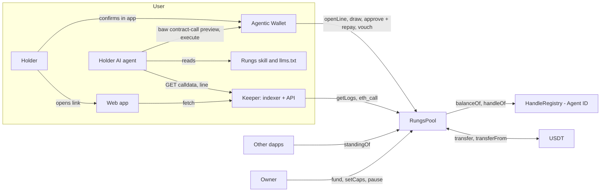

# Rungs — Technical Design

## 1. Architecture

Trust: the pool contract is the only place money rules live. The keeper is a read cache and a calldata helper; if it is wrong or down, the contract and `rungs` CLI still work.

## 2. Repo tree
```
contracts/
  src/{RungsPool.sol,LadderLib.sol,IRungsStanding.sol,IHandleRegistry.sol,RungsGate.sol}
  test/{Ladder.t.sol,LadderVectors.t.sol,Pool.t.sol,Vouch.t.sol,WriteOff.t.sol,Admin.t.sol,Invariants.t.sol,Fork.t.sol}
  test/mocks/{MockUSDT.sol,MockHandleRegistry.sol}
  script/{Deploy.s.sol,Fund.s.sol}
packages/core/src/{constants.ts,ladder.ts,types.ts,index.ts}   + test/
packages/chain/src/{addresses.ts,abi/*.ts,clients.ts,calldata.ts,read.ts}  + test/
packages/skill/{SKILL.md,llms.txt.tmpl,src/cli.ts,src/commands.ts}  + test/
apps/keeper/src/{server.ts,indexer.ts,db.ts,routes/*.ts,site.ts,stats.ts}  + test/
apps/web/{index.html,src/{main.tsx,App.tsx,styles.css,api.ts,pages/*,components/*},e2e/*}
docs/build-pack/  DECISIONS.md  PROVEN.md  OWNER-PERMISSIONS.md  SECURITY.md  README.md
```

## 3. Constants (`packages/core/src/constants.ts`, mirrored in `LadderLib.sol`)
```
UNIT            = 10n ** 18n            // USDT on BNB Chain
LIMITS          = [1, 2, 5, 10, 20, 35, 50] × UNIT      // index = level, MAX_LEVEL = 6
MIN_DRAW        = 1 × UNIT
TERM            = 7 days = 604800 s
GRACE           = 3 days = 259200 s
MIN_HOLD        = 1 day  = 86400 s
FEE_BPS         = 100
MIN_FEE         = UNIT / 100             // 0.01 USDT
LATE_FEE_BPS    = 100
MAX_VOUCHED     = 50 × UNIT              // total stake that can count for one borrower
MAX_VOUCHERS    = 3                      // per borrower
MAX_VOUCHEES    = 3                      // per voucher
MIN_VOUCH_LEVEL = 2
MIN_STAKE       = 1 × UNIT
RESERVE_TARGET_BPS = 1000                // of maxOutstanding
CAP_RAISE_DELAY = 2 days
```
Constants are compile-time. The owner cannot change them.

## 4. Ladder math (pure; the same in TypeScript and Solidity)
```
limit(level, vouched)        = LIMITS[level] + min(vouched, MAX_VOUCHED)
fee(principal)               = max(principal * FEE_BPS / 10_000, MIN_FEE)
lateFee(principal)           = principal * LATE_FEE_BPS / 10_000
phase(loan, now):
    none        if principal == 0
    writtenOff  if loan.writtenOff
    current     if now <= dueAt
    late        if now <= dueAt + GRACE
    defaultable otherwise
due(loan, now)               = principal + fee + (now > dueAt ? lateFee(principal) : 0)
need(defaults)               = 1 + min(defaults, 2)

onRepay(line, loan, now) -> (line', outcome):
    if loan.writtenOff:                      // cure
        frozen = false; level = 0; streak = 0;                     outcome = CURED
    else if now > loan.dueAt:                // late or defaultable-but-not-yet-written-off
        late += 1; streak = 0;                                     outcome = LATE
    else:
        repaid += 1
        if now - loan.drawnAt < MIN_HOLD:                          outcome = EARLY
        else if loan.principal * 2 < LIMITS[line.level]:           outcome = SMALL
        else:
            streak += 1
            if streak >= need(defaults) and level < MAX_LEVEL:
                level += 1; streak = 0;                            outcome = PROMOTED
            else:                                                  outcome = ON_TIME

onWriteOff(line) -> line':   defaults += 1; level = 0; streak = 0; frozen = true
```
Notes
- "Half the limit" uses the rung's own limit, not the vouched part.
- At `MAX_LEVEL`, a qualifying repayment keeps `streak` growing but changes nothing else; outcome `ON_TIME`.
- Counters saturate at their type maximum instead of overflowing.
- All divisions round down. `ladder-vectors.json` fixes every edge.

Loss order on write-off (principal only; the fee was never booked):
```
slashed    = min(principal, vouchedFor[borrower])     // pro rata across vouchers, remainder to the largest
fromReserve= min(principal - slashed, reserve)
socialised = principal - slashed - fromReserve        // reduces idle capital's claim; recorded, not hidden
```
Cure waterfall (the borrower later pays `principal + fee + lateFee`): slashed vouchers are credited `claimable` first (pro rata to what each lost), then the reserve gets back what it paid, then idle gets the socialised part; fee and late fee follow the normal fee rule.

Fee rule on any repayment: fee and late fee go to `reserve` until `reserve >= maxOutstanding * RESERVE_TARGET_BPS / 10_000`, the rest to `idle`.

## 5. Contracts
### 5.1 Storage
```solidity
struct Line {
    bytes32 labelhash;   // keccak256(bytes(handle)) at open
    uint64  openedAt;
    uint8   level;
    uint8   streak;
    uint16  repaid;
    uint16  late;
    uint16  defaults;
    bool    frozen;
    bool    everDrawn;
}
struct Loan {
    uint128 principal;
    uint128 fee;
    uint64  drawnAt;
    uint64  dueAt;
    bool    writtenOff;
}
mapping(address => Line) public lineOf;
mapping(address => Loan) public loanOf;
mapping(address => mapping(address => uint256)) public stakeOf;     // voucher => borrower => amount
mapping(address => address[]) internal vouchersOf;                  // borrower => vouchers (<= 3)
mapping(address => uint8) public voucheeCount;                      // voucher => count (<= 3)
mapping(address => uint256) public vouchedFor;                      // borrower => total stake
mapping(address => mapping(address => uint256)) public slashedOwed; // voucher => borrower => amount to restore on cure
mapping(address => uint256) public claimable;
uint256 public idle; uint256 public reserve; uint256 public outstanding;
uint256 public totalStaked; uint256 public totalClaimable; uint256 public socialisedLoss;
uint256 public maxOutstanding; uint32 public dailyNewLineCap;
mapping(uint256 => uint32) public newLinesOnDay;                    // day index => first draws
bool public paused;
```
Immutable: `usdt`, `registry`.

### 5.2 External functions
| Function | Who | Checks | Effect |
|---|---|---|---|
| `openLine()` | holder | `registry.balanceOf(msg.sender) > 0`; no line yet; not paused | stores `labelhash` from `handleOf`; emits `LineOpened` |
| `draw(uint256 amount)` | holder with a line | still holds the ID; not paused; not frozen; no open loan; `MIN_DRAW <= amount <= limit`; `amount <= idle`; `outstanding + amount <= maxOutstanding`; if first draw, `newLinesOnDay[today] < dailyNewLineCap` | creates the loan, sends USDT; emits `Drawn` |
| `repay()` / `repayFor(address borrower)` | anyone | an open loan exists | pulls `due` from the payer, applies `onRepay`, books money; emits `Repaid` |
| `writeOff(address borrower)` | anyone | phase is `defaultable` | applies `onWriteOff`, runs the loss order; emits `WrittenOff`, `Slashed` |
| `vouch(address borrower, uint256 amount)` | holder | holds the ID; own level ≥ 2; not frozen; borrower has a line and is not self; counts within limits; `amount >= MIN_STAKE`; `vouchedFor + amount <= MAX_VOUCHED`; not paused | pulls USDT; emits `Vouched` |
| `unvouch(address borrower, uint256 amount)` | voucher | borrower has no open loan (a written-off loan is open) | returns USDT; emits `Unvouched` |
| `claim()` | anyone with `claimable` | — | pays out; emits `Claimed` |
| `fund(uint256)`, `defund(uint256)` | owner | `defund <= idle` | moves owner capital in or out of `idle` |
| `sweepReserve(uint256)` | owner | `outstanding == 0` | moves reserve to `idle` |
| `setCaps(uint256 maxOutstanding, uint32 dailyNewLineCap)` | owner | first setting and any change that raises neither apply at once; a raise is queued for `CAP_RAISE_DELAY`; raising one while lowering the other reverts `MixedCapChange` | `executeCapsRaise()`, `cancelCapsRaise()` |
| `setPaused(bool)` | owner | — | blocks `openLine`, `draw`, `vouch` only |
| `transferOwnership` / `acceptOwnership` | owner | `Ownable2Step` | — |

`renounceOwnership` is overridden to revert.

### 5.3 Views (the public standing interface)
```solidity
interface IRungsStanding {
    struct Standing { bool hasLine; uint8 level; uint16 repaid; uint16 late; uint16 defaults; bool frozen; bool hasOpenLoan; }
    function standingOf(address holder) external view returns (Standing memory);
    function limitOf(address holder) external view returns (uint256);
    function dueOf(address holder) external view returns (uint256 amount, uint64 dueAt, uint8 phase);
}
```
`RungsGate.sol` is a 30-line example: `modifier onlyGoodStanding(uint8 minLevel)`.

### 5.4 Events
`LineOpened(address indexed holder, bytes32 indexed labelhash, string handle)` · `Drawn(address indexed holder, uint256 principal, uint256 fee, uint64 dueAt, uint8 level, uint256 vouched)` · `Repaid(address indexed holder, address indexed payer, uint256 principal, uint256 fee, uint256 lateFee, uint8 outcome, uint8 newLevel)` · `WrittenOff(address indexed holder, uint256 principal, uint256 slashed, uint256 fromReserve, uint256 socialised)` · `Slashed(address indexed voucher, address indexed holder, uint256 amount)` · `Vouched` / `Unvouched(address indexed voucher, address indexed holder, uint256 amount)` · `Claimed(address indexed who, uint256 amount)` · `Funded` / `Defunded(uint256 amount)` · `CapsSet(uint256,uint32)` · `CapsRaiseQueued(uint256,uint32,uint64)` · `PauseSet(bool)`.
Outcome codes: 0 EARLY, 1 SMALL, 2 ON_TIME, 3 PROMOTED, 4 LATE, 5 CURED.

### 5.5 Invariants (Foundry invariant tests, handler-based)
- **I1 Solvency:** `usdt.balanceOf(pool) >= idle + reserve + totalStaked + totalClaimable`.
- **I2 Book:** `outstanding == Σ principal of loans not written off`.
- **I3 Cap:** `outstanding <= maxOutstanding` after every `draw`.
- **I4 One loan:** a holder never has two loans; a frozen holder cannot draw.
- **I5 Stakes:** `totalStaked == Σ stakeOf`, `vouchedFor[b] == Σ stakeOf[*][b] <= MAX_VOUCHED`, list lengths within limits.
- **I6 Owner reach:** no owner function reduces `totalStaked`, `totalClaimable`, or any holder's wallet balance; `defund` never exceeds `idle`.
- **I7 Pull bound:** the pool never pulls more from a payer than `dueOf` at that block, and never from anyone who did not call.
- **I8 Monotone record:** `defaults` and `late` never decrease; `level` rises by at most 1 per repayment.
- **I9 Pause:** with `paused`, `repay`, `repayFor`, `unvouch`, `claim`, `writeOff` still succeed.
- **I10 Ladder parity:** `LadderLib` equals `packages/core` on every vector.

### 5.6 Fallback F2 — repay box (build only if spike S2 fails)
`repayBoxOf(address borrower) → address` is the CREATE2 address of a minimal `RepayBox` whose only function, callable by the pool, forwards its USDT balance to the pool. `settleFromBox(address borrower)` (anyone): deploys the box if needed, pulls its balance, applies up to `due`, and credits any excess to `claimable[borrower]`. A balance below `due` stays in the box. Tests T-P40–T-P44 in the test plan are written only in that case.

### 5.7 Security notes
- `nonReentrant` on every function that moves tokens; checks-effects-interactions; `SafeERC20`.
- USDT on BNB Chain has no transfer fee today; the pool still measures the balance change on every pull and reverts on a mismatch.
- `handleOf` returns user-chosen text. It is hashed on-chain and emitted once; nothing parses it.
- The registry owner can mint IDs to any address (V11). The caps bound that risk.
- Timestamps: a validator can shift a block time by seconds; all windows are days.
- No oracle, no price, no swap, no delegatecall, no upgrade.

## 6. Keeper
SQLite tables: `cursor(last_block, last_hash)`, `events(block, log_index, tx, name, holder, json)` (primary key block+log_index), `lines(holder, handle, level, streak, repaid, late, defaults, frozen, opened_at)`, `loans(holder, seq, principal, fee, drawn_at, due_at, closed_at, outcome, written_off)`, `stakes(voucher, borrower, amount)`, `team(address)`.
Indexer: `getLogs` in chunks of `LOG_CHUNK` blocks (set by spike S8) from the deploy block; re-scan the last `REORG_RESCAN_BLOCKS` each cycle and replace rows; one in-flight request; backoff on error. Derived tables are rebuilt from `events`, so a full replay gives the same database.

API (JSON; `GET` never changes state; no cookies; CORS limited to `WEB_ORIGIN`):
| Route | Returns |
|---|---|
| `GET /v1/public/site` | `{ blocked, reason, mode, notice }` where `mode` is one of `live`, `paused`, `comingSoon`; decided on the server from `COUNTRY_HEADER`, `BLOCKED_COUNTRIES`, `UNKNOWN_COUNTRY_POLICY` and the contract's `paused` |
| `GET /v1/config` | chain id, pool, registry and USDT addresses, deploy block, constants, caps, a `sourceBlock` |
| `GET /v1/lines/:address` | line, loan, phase, `due` now, limit, next step (`open`, `draw`, `repay`, `cure`, `wait`), history, vouches in and out. Read live from the contract for money fields, from the database for history |
| `GET /v1/lines/:address/actions/:action` | `action` ∈ `open`, `draw`, `approve`, `repay`, `vouch`, `unvouch`, `claim`; query `amount`, `borrower`. Returns `{ to, value, data, humanSummary, bawPreviewCommand, warnings[] }`. Validates against live state and refuses with a reason when the call would revert |
| `GET /v1/stats` | distinct holder addresses, loans by outcome, loss by rung, reserve, idle, outstanding, vouches; each with and without team wallets; `asOfBlock` |
| `GET /v1/events?after=` | paged raw events |
| `GET /llms.txt`, `GET /skill.md` | rendered from `packages/skill` with live addresses |

`:address` must be a 20-byte hex address. A handle in the path is rejected with 400 (red line 9).

## 7. Skill and CLI
`packages/skill/SKILL.md` teaches the holder's agent: check `baw wallet settings` for Developer Mode; get the address; fetch the action from the keeper or build it with `rungs`; run `baw contract-call preview`; show amount, fee, due date, target contract and any risk lines; wait for a clear yes; `execute`; then read the line again. It states that it never asks for secrets and never skips confirmation. `rungs` CLI commands: `rungs line <address>`, `rungs calldata <action> [--amount] [--borrower]`, `rungs explain <txHash>`. The CLI never signs.

## 8. Web app
React + Vite, per `web-app-shipping`. Routes: `/` (what it is, live numbers, how to start), `/line/:address` (standing), `/ladder` (rules), `/vouch` (how vouching works, plus an optional injected-wallet path), `/open` (transparency: contracts, owner permissions, stats, evidence), `/agents` (prompt and commands). Page mode comes from `GET /v1/public/site`. No sign-in, no cookies for identity; the last viewed address is kept in `localStorage` only.

## 9. Config and environment
See `08-reference/env.example`.

## 10. Deployment
Contracts: `forge script Deploy.s.sol --rpc-url $BSC_RPC_URL --broadcast` then verification (S5). Keeper: one small Node service with a volume for SQLite (Railway or Fly; the owner creates the account). Web: static build on any static host, with `/llms.txt` and `/skill.md` proxied to the keeper. Domain: must not contain "binance" or "bnb".
